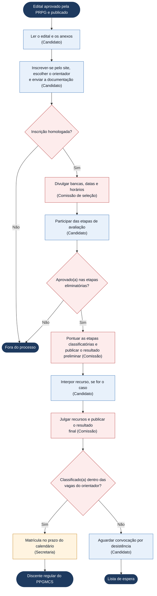

# 01 · Ingresso no Mestrado

*Programa de Pós-Graduação em Modelagem Computacional e Sistemas (PPGMCS) – Unimontes*

Como se tornar aluno(a) do Mestrado Profissional em Modelagem Computacional e Sistemas. A forma principal é o processo seletivo para aluno(a) regular. O Regulamento prevê também a admissão como aluno(a) especial e, a critério do Colegiado, por transferência ou reopção.

| | |
|---|---|
| **Público-alvo** | Candidatos(as) ao Mestrado (graduados ou concluintes); candidatos(as) a aluno(a) especial; docentes da comissão de seleção, Secretaria e Coordenação |
| **Base normativa** | Regulamento do PPGMCS (2024), Arts. 25 a 32 · Resolução CEPEx nº 024/2021 (reserva de vagas) · Resolução PPGMCS nº 001/2024, Art. 2º (linhas de pesquisa) · Edital de seleção vigente |

## Responsáveis

| Responsável | Atribuições neste processo |
|---|---|
| **Colegiado do PPGMCS** | Elaborar o edital, propor o número de vagas e os critérios de seleção e submetê-los à PRPG. Julgar pedidos de transferência e reopção. Resolver casos omissos. |
| **PRPG** | Aprovar o edital. É vedado divulgá-lo antes dessa aprovação. |
| **Candidato(a)** | Inscrever-se no prazo, com a documentação completa, escolher o(a) orientador(a) pretendido(a), participar das etapas e acompanhar todas as publicações. |
| **Comissão de seleção** | Conduzir o processo, avaliar os(as) candidatos(as) conforme o edital, divulgar os resultados e julgar os recursos, diretamente ou por comissão própria. |
| **Secretaria do PPGMCS** | Efetivar a matrícula dos(as) classificados(as). Enviar à Secretaria Geral os dados de alunos(as) transferidos(as) em até 15 dias. |

## Requisitos para ser aluno(a) regular (Art. 28)

- Ter concluído curso de graduação. O edital pode aceitar a conclusão até a data da matrícula.
- Ser aprovado(a) e classificado(a) no exame de seleção.
- Compreender texto técnico ou científico em língua estrangeira, quando o edital exigir.

## Fluxograma

*Cores: azul = candidato(a); vermelho = comissão de seleção; laranja = Secretaria.*

## Passo a passo

1. **Publicação do edital** (*Colegiado / PRPG*). O edital é publicado nos sites da Unimontes e do PPGMCS. Ele define vagas, modalidade, datas, etapas, critérios, exigência de língua estrangeira, período de ingresso e documentos de inscrição e de matrícula (Art. 29).
2. **Leitura do edital** (*Candidato(a)*). Ler o edital e os anexos e acompanhar editais complementares e retificações. O edital costuma prever um prazo para impugnação.
3. **Inscrição** (*Candidato(a)*). A inscrição é feita pelo meio indicado no edital, com a documentação completa. As vagas são distribuídas por orientador(a), e o(a) candidato(a) concorre às vagas de **um** orientador(a) pretendido(a), dentro das linhas de pesquisa do Programa.
4. **Homologação** (*Comissão / docentes do Programa*). A lista de inscrições homologadas é publicada. Documentação incompleta ou fora do padrão leva ao indeferimento.
5. **Divulgação das bancas** (*Comissão*). As bancas, datas e horários são publicados. A banca pode ser impugnada por suspeição ou impedimento (Lei Estadual nº 14.184/2002).
6. **Avaliação** (*Comissão / bancas*). As etapas, eliminatórias e classificatórias, são definidas em cada edital. Em geral, avalia-se o **pré-projeto de dissertação** (documento e apresentação) e o **currículo comprovado**.
7. **Resultado preliminar e recursos** (*Comissão / Candidato(a)*). Os recursos seguem a forma e o prazo do edital. Recursos fora do prazo ou sem fundamentação são rejeitados.
8. **Resultado final** (*Comissão*). A classificação é feita por orientador(a). Desistências podem gerar convocação dos(as) próximos(as) classificados(as).
9. **Matrícula** (*Secretaria*). Os documentos exigidos devem ser apresentados no prazo do calendário escolar. Quem não se matricula no prazo é considerado(a) desistente.

## Reserva de vagas

Em cumprimento à Resolução CEPEx nº 024/2021, os editais reservam vagas para **pessoas negras, indígenas e pessoas com deficiência**. Podem também prever vagas para **servidores(as) técnico-administrativos(as) da Unimontes**. O número de vagas, a documentação comprobatória (autodeclaração, carta descritiva, documentos de pertencimento étnico, laudo) e as regras de remanejamento constam de cada edital.

## Outras formas de admissão

| Forma | Como funciona | Base |
|---|---|---|
| **Aluno(a) especial** | Matrícula em disciplinas isoladas mediante processo seletivo público próprio. Depende de vaga e da aprovação do(a) docente da disciplina. Não dá direito ao título. Se o(a) aluno(a) ingressar como regular em até 3 anos, pode aproveitar até 16 créditos cursados com conceito mínimo B (ver Processo 08). | Arts. 27 e 31 |
| **Transferência ou reopção** | Pedido apreciado pelo Colegiado, com os documentos exigidos e o comprovante de vínculo no curso de origem. O(a) aluno(a) deve cursar no PPGMCS pelo menos 25% dos créditos exigidos. | Art. 30 |

## Linhas de pesquisa (Res. 001/2024)

- **Modelagem Computacional no Contexto de Serviços:** modelos com Inteligência Computacional, Otimização e Ciência de Dados aplicados a saúde, agricultura, transportes, materiais e educação.
- **Modelagem Computacional no Contexto Industrial:** simulação e previsão do comportamento de sistemas complexos, como projeto de produtos, otimização de processos, impacto ambiental, desempenho e riscos.

## Pontos de atenção

- O(a) candidato(a) é responsável por acompanhar todas as publicações do processo seletivo.
- A inscrição implica aceitar as normas do edital.
- O uso de documentos ou informações falsas leva à eliminação a qualquer tempo, mesmo após a matrícula.
- A aprovação na seleção não garante bolsa.

---

*Documento informativo. Em caso de divergência, prevalecem as normas oficiais do PPGMCS e da Unimontes. Casos omissos são resolvidos pelo Colegiado do Programa.*
