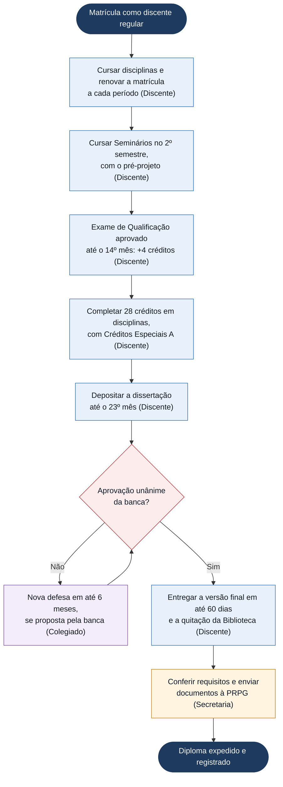

# 02 · Requisitos para Obtenção do Título de Mestre

*Programa de Pós-Graduação em Modelagem Computacional e Sistemas (PPGMCS) – Unimontes*

O que o(a) discente precisa cumprir, e em que prazos, para receber o diploma de Mestre em Modelagem Computacional e Sistemas: 38 créditos, disciplinas obrigatórias, qualificação, defesa e entrega da versão final.

| | |
|---|---|
| **Público-alvo** | Discentes regulares do Mestrado, em especial ingressantes; orientadores(as); Secretaria e Coordenação |
| **Base normativa** | Resolução PPGMCS nº 001/2024, Arts. 3º e 5º a 10 · Regulamento do PPGMCS (2024), Arts. 12, 32, 35, 37, 38, 40, 44, 49, 53, 55 e 56 · Resolução PPGMCS nº 004/2019, Art. 9º |

## Responsáveis

| Responsável | Atribuições neste processo |
|---|---|
| **Discente** | Planejar o percurso com o(a) orientador(a), renovar a matrícula a cada período e cumprir créditos e prazos. |
| **Orientador(a)** | Aprovar o plano de estudos, dar anuência às matrículas e acompanhar os prazos. |
| **Secretaria do PPGMCS** | Registrar matrículas e créditos, conferir requisitos e enviar a documentação de diplomação à PRPG. |
| **Colegiado do PPGMCS** | Decidir prorrogações de prazo, casos excepcionais e desligamentos. |
| **PRPG / Secretaria Geral** | Expedir o diploma (PRPG) e registrá-lo (Secretaria Geral). |

## Composição dos 38 créditos

| Componente | Créditos | Observação |
|---|---:|---|
| Seminários (obrigatória) | 4 | Cursada no 2º semestre |
| 2 entre: Introdução à Modelagem Computacional, Visualização Científica e Estatística e Probabilidade | 8 | Obrigatórias de escolha, 4 créditos cada |
| Créditos Especiais A (obrigatória) | 4 | Por produção acadêmica (ver Processo 05) |
| Disciplinas optativas | 12 | 3 disciplinas de 4 créditos |
| **Subtotal em disciplinas** | **28** | |
| Exame de Qualificação | 4 | Até o 14º mês (ver Processo 03) |
| Dissertação (Dissertação I a IV) | 6 | Concluída com a aprovação na defesa (ver Processo 04) |
| **Total** | **38** | Res. 001/2024, Art. 5º |

**Optativas (4 créditos, 60 h cada):**
- Introdução ao Aprendizado de Máquina
- Introdução à Inteligência Computacional
- Aplicações de Otimização
- Aplicações de Ciência de Dados
- Aplicações de Redes Neurais Artificiais
- Aplicações de Sistemas Nebulosos
- Empreendedorismo e Inovação
- Créditos Especiais B e C
- Estudos Dirigidos A, B e C (ver Processo 06)
- Tópicos Especiais A, B e C

## Fluxograma

*Cores: azul = discente; vermelho = banca; roxo = Colegiado; laranja = Secretaria.*

## Passo a passo

1. **Disciplinas** (*Discente*). Matricular-se a cada período, com anuência do(a) orientador(a). Deixar de renovar a matrícula leva à exclusão (Art. 35).
2. **Seminários** (*Discente*). A disciplina é obrigatória para todos e cursada no 2º semestre, com apresentação do pré-projeto de dissertação. Quem não puder cursá-la nesse período deve justificar ao Colegiado.
3. **Exame de Qualificação** (*Discente*). Exige pelo menos 12 créditos e aprovação em Seminários (ver Processo 03).
4. **Integralizar as disciplinas** (*Discente*). Completar os 28 créditos em disciplinas, incluindo Créditos Especiais A (ver Processo 05).
5. **Depósito e defesa** (*Discente*). Depositar a dissertação na Secretaria até o 23º mês (ver Processo 04). A aprovação na defesa conclui Dissertação IV.
6. **Insucesso na defesa** (*Colegiado*). Mediante proposta justificada da banca, o Colegiado pode conceder nova defesa em até 6 meses, respeitado o prazo máximo do curso.
7. **Versão final** (*Discente*). Entregar, em até 60 dias:
   - a versão final, com as correções da banca;
   - a versão eletrônica;
   - o termo de autorização de divulgação;
   - a comprovação de quitação com a Biblioteca.
8. **Diplomação** (*Secretaria → PRPG*). A Secretaria confere o cumprimento do Art. 49 e envia a documentação à PRPG, que expede o diploma.

## Regras de aprovação e frequência

- 1 crédito = 15 horas-aula (Art. 37).
- Os créditos só são conferidos com conceito mínimo **C** e **75% de frequência**. Não há abono de faltas (Art. 38).
- Escala de conceitos (Art. 42):
  - A: 90 a 100
  - B: 80 a 89
  - C: 70 a 79
  - D: 60 a 69
  - E: 40 a 59
  - F: 0 a 39
- Quando a escala não se aplica, usa-se APTO/INAPTO (Art. 43).

## Prazos

| O quê | Prazo | Fonte |
|---|---|---|
| Duração máxima do curso | 24 meses a partir da 1ª matrícula regular | Regulamento, Art. 12, III |
| Seminários | 2º semestre | Res. 001/2024, Art. 6º |
| Exame de Qualificação concluído | Até o 14º mês | Res. 001/2024, Art. 9º |
| Depósito da dissertação | Até o 23º mês, prorrogável por 6 meses, com justificativa ao Colegiado | Res. 001/2024, Art. 10 |
| Pedido de prorrogação do prazo máximo (até 6 meses) | Pelo menos 2 meses antes do fim do prazo | Regulamento, Art. 12, §2º |
| Entrega da versão final | Até 60 dias após a defesa | Res. 004/2019, Art. 9º, §1º |

## Documentos

| Documento | Observação |
|---|---|
| Pedido de prorrogação de prazo | Justificado, com parecer favorável do(a) orientador(a), plano de estudo e novo cronograma de até 6 meses. O(a) discente deve ter cumprido os demais requisitos do curso. |
| Versão final e versão eletrônica da dissertação | Ou relatório descritivo nos moldes do INPI, no caso de produtos e processos inovadores. |
| Termo de consentimento para divulgação on-line | Após a aprovação. |
| Comprovante de quitação com a Biblioteca Universitária | Exigido para o diploma (Arts. 49, IV e 53, II). |

## Pontos de atenção

- **Desligamento automático (Art. 56).** O(a) discente é desligado(a) se:
  - obtiver conceito D, E ou F mais de uma vez, na mesma disciplina ou em disciplinas diferentes;
  - não concluir a qualificação no prazo;
  - ultrapassar 24 meses (ou 30, com prorrogação) sem concluir o curso;
  - tiver desempenho insuficiente, a critério do Colegiado;
  - não renovar a matrícula;
  - cometer falta disciplinar grave.
- O período de trancamento total não conta no prazo máximo (ver Processo 07).
- Se a defesa for antecipada, as disciplinas de Dissertação que faltarem são consideradas cursadas (Art. 49, §2º).

---

*Documento informativo. Em caso de divergência, prevalecem as normas oficiais do PPGMCS e da Unimontes. Casos omissos são resolvidos pelo Colegiado do Programa.*
