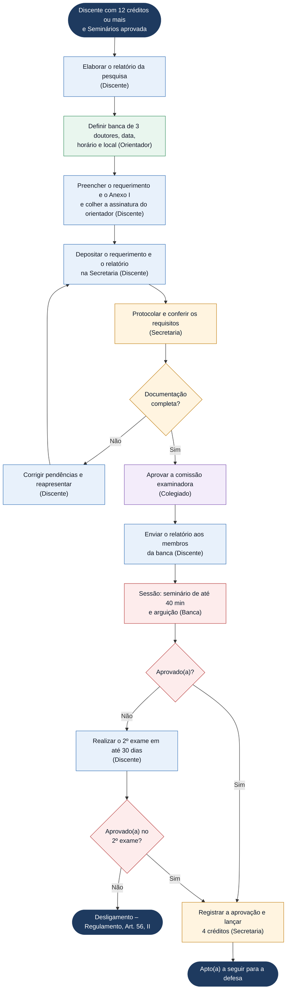

# 03 · Agendamento do Exame de Qualificação

*Programa de Pós-Graduação em Modelagem Computacional e Sistemas (PPGMCS) – Unimontes*

Como o(a) discente solicita, organiza e realiza o Exame de Qualificação do Mestrado. O exame é obrigatório, vale 4 créditos e é pré-requisito para a defesa da dissertação.

| | |
|---|---|
| **Público-alvo** | Discentes regulares do Mestrado; orientadores(as) e coorientadores(as); Secretaria e Coordenação |
| **Base normativa** | Regulamento do PPGMCS (2024), Arts. 41, 44, II e 56, II · Resolução PPGMCS nº 004/2019, Arts. 1º a 4º · Resolução PPGMCS nº 001/2024, Arts. 5º e 9º |

## Responsáveis

| Responsável | Atribuições neste processo |
|---|---|
| **Discente** | Cumprir os requisitos, preencher o requerimento e o Anexo I, depositar o relatório na Secretaria, enviar cópias à banca e apresentar o seminário. |
| **Orientador(a)** | Autorizar a inscrição com assinatura no requerimento, propor banca, data e local e presidir a sessão. |
| **Secretaria do PPGMCS** | Protocolar o pedido, conferir a documentação, encaminhar ao Colegiado e registrar o resultado no histórico. |
| **Colegiado do PPGMCS** | Aprovar a comissão examinadora e decidir casos não previstos. |
| **Banca examinadora** | Avaliar o relatório e o seminário, arguir o(a) discente e emitir o resultado. |

## Requisitos

- Ser discente regular, com matrícula ativa.
- Ter integralizado **pelo menos 12 créditos** em disciplinas (Res. 004/2019, Art. 3º, d).
- Ter sido **aprovado(a) na disciplina Seminários** (Res. 004/2019, Art. 3º, c).
- Apresentar o **relatório do trabalho de investigação**.
- Apresentar o **requerimento de inscrição com autorização do(a) orientador(a)**.

**Conteúdo do relatório (Art. 3º, a).** O relatório deve demonstrar que a dissertação pode ser concluída no prazo e conter:

- introdução com a base teórica que fundamenta o trabalho;
- objetivos;
- metodologias;
- resultados preliminares;
- principais produtos a desenvolver;
- proposta de continuidade, com cronograma.

**Comissão examinadora e sessão.**

- A comissão tem **3 membros com título de Doutor** (Art. 4º).
- O(a) discente faz uma apresentação oral de **até 40 minutos**.
- A arguição tem **até 30 minutos por examinador**.
- O(a) próprio(a) discente envia as cópias do relatório (digitais ou impressas) aos membros.

## Fluxograma

*Cores: azul = discente; verde = orientador(a); laranja = Secretaria; roxo = Colegiado; vermelho = banca.*

## Passo a passo

1. **Elaborar o relatório** (*Discente*). Redigir o relatório com os tópicos exigidos e revisá-lo com o(a) orientador(a).
2. **Definir banca e data** (*Orientador(a)*). Indicar os três membros, a data, o horário e o local ou link, de modo que o exame termine até o 14º mês de curso.
3. **Realizar o convite** (*Discente*). Enviar e-mail ou comunicação formal aos integrantes sugeridos, verificando disponibilidade de dia e horário.
4. **Preencher o requerimento** (*Discente*). Preencher o Requerimento de Inscrição no Exame de Qualificação e o Anexo I, com dados do aluno, título, data, local, horário e banca. O documento leva a assinatura do(a) discente e do(a) orientador(a).
5. **Depositar na Secretaria** (*Discente*). Entregar o requerimento e uma cópia do relatório. A partir do depósito, o exame deve ocorrer em até 2 meses.
6. **Conferência** (*Secretaria*). A Secretaria registra o protocolo e confere os créditos, a aprovação em Seminários e os documentos. Se faltar algum item, o(a) discente complementa e reapresenta.
7. **Aprovação da banca** (*Colegiado*). O Colegiado aprova a comissão examinadora (Regulamento, Art. 17, XXIII), e a Secretaria divulga a data e o local.
8. **Envio à banca** (*Discente*). O(a) discente envia o relatório a cada membro com antecedência razoável.
9. **Realização do exame** (*Banca*). O(a) discente apresenta o seminário e, em seguida, cada examinador faz sua arguição.
10. **Registro** (*Secretaria*). A Secretaria arquiva a ata e lança os 4 créditos do exame no histórico.
11. **Segundo exame** (*Discente*). Em caso de reprovação, o segundo exame deve ocorrer em até 30 dias após o primeiro. Se não ocorrer nesse prazo, o(a) discente é considerado(a) reprovado(a) novamente.

## Prazos

| O quê | Prazo | Fonte |
|---|---|---|
| Exame de Qualificação concluído (créditos cumpridos) | Até o 14º mês do curso | Res. 001/2024, Art. 9º |
| Realização do exame após o depósito do pedido | Até 2 meses | Res. 004/2019, Art. 1º, II |
| Segundo exame, em caso de reprovação | Até 30 dias após o primeiro | Res. 004/2019, Art. 1º, III |

## Documentos e formulários

| Documento | Observação |
|---|---|
| Requerimento de Inscrição no Exame de Qualificação e Anexo I ([modelo](../formularios/requerimento-qualificacao.docx)) | Assinado pelo(a) discente e pelo(a) orientador(a). |
| Relatório do trabalho de investigação | 1 cópia para a Secretaria. As cópias da banca são enviadas pelo(a) discente. |
| Comprovação de créditos e da aprovação em Seminários | A Secretaria confere no histórico. |

## Pontos de atenção

- Não concluir a qualificação no prazo leva ao **desligamento automático** (Regulamento, Art. 56, II).
- O exame precisa estar concluído até o 14º mês. Deposite o pedido com folga, para que a banca e uma eventual segunda tentativa (30 dias) caibam nesse limite.

---

*Documento informativo. Em caso de divergência, prevalecem as normas oficiais do PPGMCS e da Unimontes. Casos omissos são resolvidos pelo Colegiado do Programa.*
