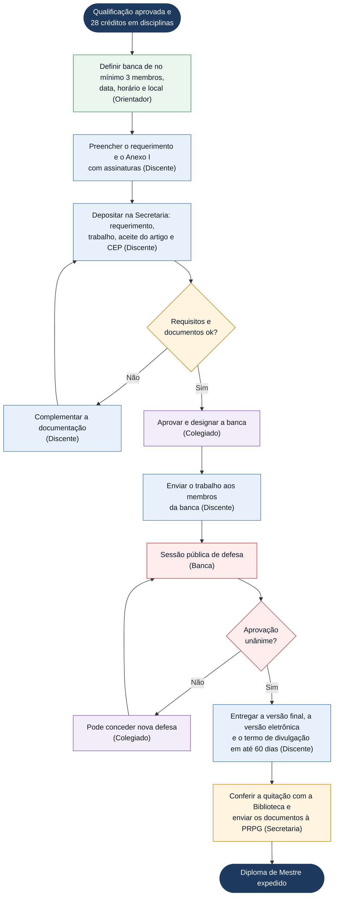

# 04 · Agendamento da Defesa de Dissertação

*Programa de Pós-Graduação em Modelagem Computacional e Sistemas (PPGMCS) – Unimontes*

Como solicitar, agendar e realizar a defesa pública do trabalho de conclusão do Mestrado, e o que fazer depois dela (versão final e diplomação).

| | |
|---|---|
| **Público-alvo** | Discentes regulares aprovados(as) no Exame de Qualificação; orientadores(as), coorientadores(as) e membros de banca; Secretaria e Coordenação |
| **Base normativa** | Regulamento do PPGMCS (2024), Arts. 40, 44 a 49 e 53 · Resolução PPGMCS nº 004/2019, Arts. 5º a 10 · Resolução PPGMCS nº 001/2024, Arts. 5º e 10 |

## Responsáveis

| Responsável | Atribuições neste processo |
|---|---|
| **Discente** | Cumprir os requisitos, preencher o requerimento e o Anexo I, depositar o trabalho, enviar cópias à banca, defender e entregar a versão final. |
| **Orientador(a)** | Dar anuência ao pedido, indicar banca e data e presidir a sessão. |
| **Secretaria do PPGMCS** | Protocolar e conferir o pedido, divulgar a sessão, arquivar a ata e a folha de aprovação e encaminhar a diplomação. |
| **Colegiado do PPGMCS** | Aprovar e designar a banca. Decidir sobre defesa fechada e sobre nova defesa em caso de insucesso. |
| **Banca examinadora** | Avaliar o trabalho, lavrar e assinar a ata e a folha de aprovação e indicar as correções. |

## Requisitos

- Ter integralizado **todos os créditos em disciplinas** (28), incluindo Créditos Especiais A (Regulamento, Arts. 40 e 44, I).
- Ter sido **aprovado(a) no Exame de Qualificação** (Art. 44, II).
- Ter **artigo sobre o trabalho aceito** em evento de abrangência nacional ou em revista indexada pela CAPES (Res. 004/2019, Art. 5º). A exigência pode ser dispensada quando o trabalho de conclusão for um produto (Portaria Normativa CAPES nº 17/2009, Art. 7º, §3º).
- Apresentar a **aprovação do Comitê de Ética em Pesquisa**, se o trabalho envolver seres humanos ou animais (Res. 004/2019, Art. 8º, a).
- Depositar o trabalho **até o 23º mês** do curso (Res. 001/2024, Art. 10).

## Banca examinadora

- A banca tem **no mínimo 3 membros**, todos com título de Doutor:
  - o(a) **orientador(a)**, como presidente;
  - **1 docente credenciado(a) no PPGMCS**;
  - **1 membro externo**.
- Coorientadores(as) podem participar, mas não contam para o número mínimo.
- O(a) orientador(a) pode indicar os membros e a data. A banca é aprovada e designada pelo Colegiado (Art. 46).

## Formatos aceitos (Res. 004/2019, Art. 7º)

- Dissertação em português. Trabalhos em inglês ou espanhol são aceitos em casos excepcionais, a critério do Colegiado.
- Artigo publicado em periódico com, no mínimo, Qualis CAPES B1.
- Registro de propriedade intelectual ou de software, ou protótipo para desenvolvimento de produto.

## Fluxograma

*Cores: azul = discente; verde = orientador(a); laranja = Secretaria; roxo = Colegiado; vermelho = banca.*

## Passo a passo

1. **Definir banca e data** (*Orientador(a)*). Orientador(a) e discente definem a banca (orientador(a), 1 docente credenciado(a) no PPGMCS e 1 membro externo), a data, o horário e o local ou link.
2. **Preencher o requerimento** (*Discente*). Preencher o Requerimento de Defesa de Dissertação e o Anexo I, com dados do aluno, título, data, local, horário e banca. O documento leva a assinatura do(a) discente e do(a) orientador(a).
3. **Depósito** (*Discente*). Até o 23º mês, entregar na Secretaria:
   - o requerimento;
   - uma cópia do trabalho;
   - o comprovante de aceite do artigo (carta ou e-mail do editor);
   - a aprovação do Comitê de Ética, se for o caso.
4. **Conferência** (*Secretaria*). A Secretaria confere requisitos e documentos. Se faltar algum item, o(a) discente complementa e reapresenta.
5. **Aprovação da banca** (*Colegiado*). O Colegiado aprova e designa a banca. Nos casos de proteção intelectual, decide se a sessão será fechada, com termo de sigilo.
6. **Envio à banca** (*Discente*). Com anuência do(a) orientador(a), o(a) discente envia as cópias, digitais ou impressas. A Secretaria divulga a sessão.
7. **Defesa** (*Banca*). Sessão pública, com apresentação e arguição. Lavram-se a ata e a Folha de Aprovação, assinadas por todos os membros. A aprovação exige **decisão unânime** (Art. 47).
8. **Insucesso** (*Colegiado*). Mediante proposta justificada da banca, o Colegiado pode conceder nova defesa em até 6 meses, respeitado o prazo máximo do curso. Se o(a) discente já teve prorrogação, o prazo pode ser de até 60 dias.
9. **Versão final** (*Discente*). Em até 60 dias, entregar:
   - a versão final, com as correções da banca;
   - a versão eletrônica completa (ou relatório nos moldes do INPI, para produtos e processos inovadores);
   - o termo de consentimento para divulgação on-line.
10. **Diplomação** (*Secretaria*). Com a quitação junto à Biblioteca, a Secretaria envia a documentação à PRPG para a expedição do diploma.

## Prazos

| O quê | Prazo | Fonte |
|---|---|---|
| Depósito da dissertação | Até o 23º mês, prorrogável por 6 meses, com justificativa ao Colegiado | Res. 001/2024, Art. 10 |
| Entrega da versão final | Até 60 dias após a aprovação | Res. 004/2019, Art. 9º, §1º |
| Nova defesa em caso de insucesso | Até 6 meses (até 60 dias se já houve prorrogação) | Regulamento, Art. 48; Res. 004/2019, Art. 9º, §2º |

## Documentos e formulários

| Documento | Observação |
|---|---|
| Requerimento de Defesa de Dissertação e Anexo I ([modelo](../formularios/requerimento-defesa.docx)) | Assinado pelo(a) discente e pelo(a) orientador(a). |
| 1 cópia do trabalho | As cópias da banca são enviadas pelo(a) discente. |
| Comprovante de artigo aceito | Carta ou e-mail de aceite do editor. |
| Aprovação do Comitê de Ética | Somente para pesquisas com seres humanos ou animais. |
| Ata, Folha de Aprovação, versão final, termo de divulgação e quitação da Biblioteca | Após a defesa. |

## Pontos de atenção

- A aprovação na defesa é o que conclui a disciplina Dissertação IV (Regulamento, Art. 49, §3º).
- A sessão é pública. Só pode ser fechada, por decisão do Colegiado, em casos de proteção intelectual (Art. 46, §5º).

---

*Documento informativo. Em caso de divergência, prevalecem as normas oficiais do PPGMCS e da Unimontes. Casos omissos são resolvidos pelo Colegiado do Programa.*
