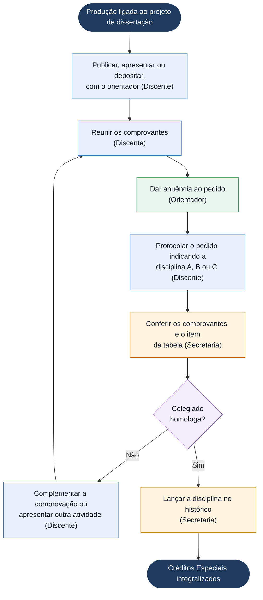

# 05 · Atividade Acadêmica de Créditos Especiais

*Programa de Pós-Graduação em Modelagem Computacional e Sistemas (PPGMCS) – Unimontes*

Como obter créditos por produção acadêmica ligada ao projeto de dissertação. **Créditos Especiais A** é obrigatória para todos(as). **Créditos Especiais B e C** são optativas e usam a mesma tabela de atividades.

| | |
|---|---|
| **Público-alvo** | Discentes regulares do Mestrado; orientadores(as); Secretaria e Colegiado |
| **Base normativa** | Resolução PPGMCS nº 001/2024, Arts. 3º, 5º e 8º · Regulamento do PPGMCS (2024), Arts. 17, XVII, 37, §1º e 50 |

## Responsáveis

| Responsável | Atribuições neste processo |
|---|---|
| **Discente** | Produzir a atividade com a participação do(a) orientador(a), reunir os comprovantes e solicitar a atribuição dos créditos. |
| **Orientador(a)** | Participar da produção, quando o item da tabela exigir, e dar anuência ao pedido. |
| **Secretaria do PPGMCS** | Protocolar, conferir os comprovantes e lançar a disciplina no histórico. |
| **Colegiado do PPGMCS** | Analisar e homologar a atribuição dos créditos. |

## Requisitos

- A atividade deve estar **relacionada ao projeto de dissertação**.
- Deve haver **participação do(a) orientador(a)**, conforme cada item da tabela.
- Deve ser respeitada a **posição de autoria** exigida em cada item (primeiro ou segundo autor).

## Tabela de atividades (Res. 001/2024, Art. 8º)

| Atividade | Créditos |
|---|---:|
| Artigo em revista Qualis **A1 a A4**, como 1º ou 2º autor, com participação do(a) orientador(a) | **8** |
| Depósito de patente relacionada ao projeto de dissertação | **8** |
| Artigo em revista Qualis **B1 a B4**, como 1º ou 2º autor, com participação do(a) orientador(a) | **4** |
| Livro ou capítulo de livro com o(a) orientador(a), como 1º autor | **4** |
| Trabalho completo em anais de evento, como 1º autor, com participação do(a) orientador(a) | **4** |
| Resumo expandido em evento oficial da Unimontes, como 1º autor, com participação do(a) orientador(a) | **2** |

**Como os créditos se distribuem:**

- **Créditos Especiais A** (4 créditos) é **obrigatória** e integra os 28 créditos em disciplinas.
- **Créditos Especiais B e C** (4 créditos cada) são optativas e se cumprem com as mesmas atividades (Art. 8º, §1º).
- Uma atividade de **8 créditos** pode completar **duas** disciplinas de créditos especiais (Art. 8º, §2º). Por exemplo, um artigo em revista A2 completa Créditos Especiais A e B.

## Fluxograma

*Cores: azul = discente; verde = orientador(a); laranja = Secretaria; roxo = Colegiado.*

## Passo a passo

1. **Realizar a atividade** (*Discente*). Desenvolver a produção conforme a tabela, observando a autoria e a participação do(a) orientador(a).
2. **Reunir comprovantes** (*Discente*). Separar comprovantes que identifiquem autoria, veículo, estrato Qualis (quando for o caso) e data.
3. **Anuência** (*Orientador(a)*). O(a) orientador(a) confirma a relação com o projeto e a sua participação.
4. **Pedido** (*Discente*). Protocolar o pedido na Secretaria, indicando qual disciplina de créditos especiais deve ser integralizada.
5. **Conferência** (*Secretaria*). A Secretaria confere os documentos e o enquadramento na tabela e encaminha ao Colegiado.
6. **Homologação** (*Colegiado*). O Colegiado analisa o pedido. Em caso de indeferimento, o(a) discente pode complementar a comprovação ou apresentar outra atividade.
7. **Lançamento** (*Secretaria*). A Secretaria lança a disciplina de créditos especiais no histórico.

## Prazos

| O quê | Prazo | Fonte |
|---|---|---|
| Integralizar Créditos Especiais A | Antes do pedido de defesa, pois todos os créditos em disciplinas são pré-requisito | Regulamento, Arts. 40 e 44, I |

## Documentos

| Documento | Observação |
|---|---|
| Requerimento de atribuição de créditos especiais | Com anuência do(a) orientador(a). |
| Comprovantes da atividade | Artigo publicado ou aceite, anais, certificado de apresentação ou comprovante de depósito de patente. |

## Pontos de atenção

- Os créditos especiais servem **somente para completar** o número de créditos necessários no curso (Regulamento, Art. 50).
- Planeje Créditos Especiais A com antecedência. Publicações costumam levar meses entre a submissão e o aceite.

---

*Documento informativo. Em caso de divergência, prevalecem as normas oficiais do PPGMCS e da Unimontes. Casos omissos são resolvidos pelo Colegiado do Programa.*
