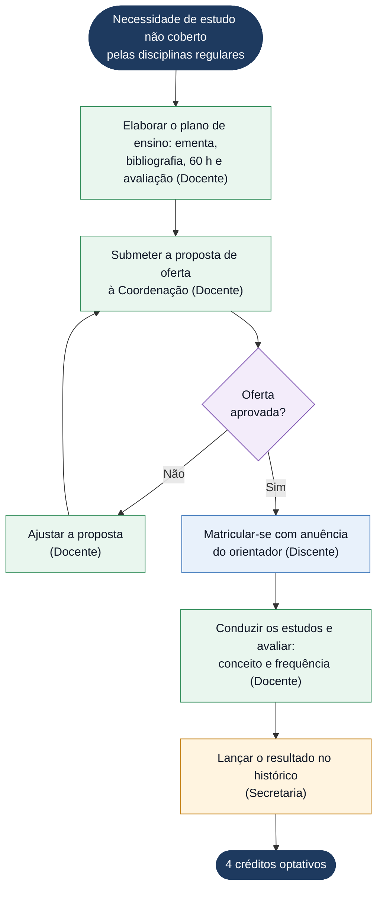

# 06 · Disciplinas de Estudos Dirigidos

*Programa de Pós-Graduação em Modelagem Computacional e Sistemas (PPGMCS) – Unimontes*

Estudos Dirigidos A, B e C são disciplinas optativas de ementa e bibliografia variáveis, com 4 créditos (60 h) cada. Permitem um estudo orientado sobre tema não coberto pelas disciplinas regulares.

| | |
|---|---|
| **Público-alvo** | Discentes regulares do Mestrado; orientadores(as) e docentes do PPGMCS; Coordenação, Colegiado e Secretaria |
| **Base normativa** | Resolução PPGMCS nº 001/2024, Arts. 3º (Tabela 1) e 11 · Regulamento do PPGMCS (2024), Arts. 17, XVI e XXVII, 32, 37 e 38 |

## Responsáveis

| Responsável | Atribuições neste processo |
|---|---|
| **Discente** | Propor o tema com o(a) orientador(a), matricular-se e cumprir as atividades e avaliações. |
| **Docente responsável** | Elaborar o plano de ensino (ementa, bibliografia, cronograma, avaliação), conduzir a disciplina e lançar conceito e frequência. |
| **Orientador(a)** | Dar anuência à matrícula (Regulamento, Art. 32, §1º). |
| **Colegiado do PPGMCS** | Aprovar a oferta e as diretrizes da disciplina (Art. 17, XVI e XXVII). |
| **Secretaria do PPGMCS** | Registrar a oferta e a matrícula e lançar o resultado. |

## Características

| Disciplina | Tipo | Carga horária | Créditos | Ementa e bibliografia |
|---|---|---|---:|---|
| Estudos Dirigidos A | Optativa | 60 h | 4 | Variáveis |
| Estudos Dirigidos B | Optativa | 60 h | 4 | Variáveis |
| Estudos Dirigidos C | Optativa | 60 h | 4 | Variáveis |

Aprovação com conceito mínimo C e 75% de frequência (Regulamento, Art. 38).

**Conteúdo do plano de ensino:**

- tema e justificativa, com a relação com a linha de pesquisa ou com o projeto;
- ementa e objetivos;
- bibliografia;
- cronograma das 60 horas (leituras, encontros, produtos);
- forma de avaliação e controle de frequência.

## Fluxograma

*Cores: azul = discente; verde = docente responsável; roxo = Colegiado; laranja = Secretaria.*

## Passo a passo

1. **Plano de ensino** (*Docente responsável*). O(a) docente elabora o plano, em geral com o(a) orientador(a) do(a) discente.
2. **Submissão** (*Docente responsável*). Enviar a proposta à Coordenação antes do período de matrícula, indicando a letra (A, B ou C).
3. **Aprovação da oferta** (*Colegiado*). O Colegiado aprova a oferta (Art. 17, XXVII) ou pede ajustes.
4. **Matrícula** (*Discente*). Matrícula no período do calendário escolar, com anuência do(a) orientador(a).
5. **Realização e avaliação** (*Docente responsável*). O(a) docente conduz as atividades e atribui conceito (A a F) e frequência.
6. **Registro** (*Secretaria*). Com conceito C ou superior e frequência de pelo menos 75%, são lançados 4 créditos optativos.

## Prazos

| O quê | Prazo | Fonte |
|---|---|---|
| Matrícula | Período de matrícula do calendário escolar | Regulamento, Art. 32 |

## Documentos

| Documento | Observação |
|---|---|
| Plano de ensino da disciplina | Elaborado pelo(a) docente responsável. |

---

*Documento informativo. Em caso de divergência, prevalecem as normas oficiais do PPGMCS e da Unimontes. Casos omissos são resolvidos pelo Colegiado do Programa.*
