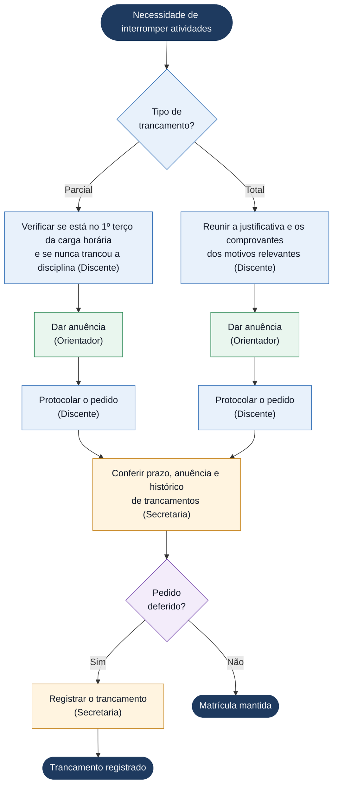

# 07 · Trancamento Parcial e Total de Matrícula

*Programa de Pós-Graduação em Modelagem Computacional e Sistemas (PPGMCS) – Unimontes*

Como suspender a matrícula em uma ou mais disciplinas (trancamento parcial) ou no curso inteiro (trancamento total), e quais são os efeitos de cada um sobre os prazos.

| | |
|---|---|
| **Público-alvo** | Discentes regulares do Mestrado; orientadores(as); Secretaria e Colegiado |
| **Base normativa** | Regulamento do PPGMCS (2024), Arts. 17, XVII, 33, 34, 35 e 56, III e V |

## Responsáveis

| Responsável | Atribuições neste processo |
|---|---|
| **Discente** | Formalizar o pedido no prazo, com justificativa e anuência do(a) orientador(a). |
| **Orientador(a)** | Dar anuência ao pedido. Pode ser substituído(a) por docente indicado(a) pelo Colegiado. |
| **Secretaria do PPGMCS** | Protocolar, verificar o prazo e o histórico de trancamentos e registrar a decisão. |
| **Colegiado do PPGMCS** | Decidir sobre o pedido (Art. 17, XVII). |

## Parcial × total

| Aspecto | Trancamento parcial | Trancamento total |
|---|---|---|
| Abrangência | Uma ou mais disciplinas | Toda a matrícula no curso |
| Quando pedir | No **primeiro 1/3 da carga horária** da disciplina | Sem prazo fixado no Regulamento |
| Motivo | Não exigido pela norma | **Motivos relevantes**, comprovados |
| Anuência | Orientador(a) ou docente indicado(a) pelo Colegiado | Orientador(a) ou docente indicado(a) pelo Colegiado |
| Limite | **Uma vez** por atividade acadêmica durante o curso | — |
| Efeito no prazo do curso | Nenhum: o prazo de 24 meses continua correndo | O período trancado **não conta** no prazo máximo |
| Quem decide | Colegiado | Colegiado |
| Base | Art. 33 | Arts. 34 e 56, III |

## Fluxograma

*Cores: azul = discente; verde = orientador(a); laranja = Secretaria; roxo = Colegiado.*

## Passo a passo

**Trancamento parcial**

1. **Verificar as condições** (*Discente*). O pedido só cabe no primeiro terço da carga horária da disciplina e uma única vez por atividade acadêmica.
2. **Anuência** (*Orientador(a)*). O(a) orientador(a), ou docente indicado(a) pelo Colegiado, assina o pedido.
3. **Protocolo** (*Discente*). Protocolar o pedido na Secretaria, indicando a(s) disciplina(s).

**Trancamento total**

1. **Justificativa** (*Discente*). Descrever os motivos relevantes e anexar os comprovantes.
2. **Anuência** (*Orientador(a)*). O(a) orientador(a), ou docente indicado(a) pelo Colegiado, assina o pedido.
3. **Protocolo** (*Discente*). Protocolar o pedido na Secretaria, indicando o período pretendido.

**Etapas comuns**

1. **Conferência** (*Secretaria*). A Secretaria confere os requisitos e encaminha ao Colegiado.
2. **Decisão** (*Colegiado*). O Colegiado defere ou indefere o pedido.
3. **Registro** (*Secretaria*). A Secretaria registra o trancamento. No trancamento total, anota o período suspenso para recalcular o prazo máximo.

## Documentos

| Documento | Observação |
|---|---|
| Requerimento de trancamento (parcial ou total) | Com anuência do(a) orientador(a). |
| Comprovantes dos motivos (trancamento total) | Atestados, declarações ou outros documentos. |

## Pontos de atenção

- **Não confunda trancamento com abandono.** Quem deixa de renovar a matrícula em um período é **excluído(a)** do curso (Arts. 35 e 56, V). O trancamento total é a via formal para interromper o curso.
- Disciplinas obrigatórias trancadas precisam ser cursadas em outra oferta.

---

*Documento informativo. Em caso de divergência, prevalecem as normas oficiais do PPGMCS e da Unimontes. Casos omissos são resolvidos pelo Colegiado do Programa.*
