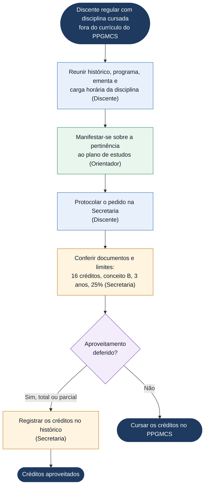

# 08 · Aproveitamento de Disciplinas Cursadas em Outro Programa

*Programa de Pós-Graduação em Modelagem Computacional e Sistemas (PPGMCS) – Unimontes*

Como pedir que créditos obtidos em outro programa de pós-graduação (stricto ou lato sensu), ou em disciplinas isoladas, sejam aproveitados na integralização do Mestrado do PPGMCS.

| | |
|---|---|
| **Público-alvo** | Discentes regulares do Mestrado; ex-alunos(as) especiais que ingressaram como regulares; discentes transferidos(as) ou reoptantes; orientadores(as), Secretaria e Colegiado |
| **Base normativa** | Regulamento do PPGMCS (2024), Arts. 17, XVII, 30, §1º, 31, §§3º e 4º, 37, 38 e 39 |

## Responsáveis

| Responsável | Atribuições neste processo |
|---|---|
| **Discente** | Reunir a documentação da disciplina de origem e protocolar o pedido. |
| **Orientador(a)** | Manifestar-se sobre a pertinência da disciplina ao plano de estudos. |
| **Secretaria do PPGMCS** | Protocolar, conferir a documentação e registrar os créditos aproveitados. |
| **Colegiado do PPGMCS** | Decidir sobre o aproveitamento, a seu critério (Art. 39), podendo ouvir docente da área. |

## Requisitos

- Ser discente regular do PPGMCS. Só discentes regulares integralizam créditos para o título.
- Os créditos devem ter sido obtidos em curso de pós-graduação **stricto ou lato sensu**, ou em disciplinas isoladas (Art. 39).
- O(a) discente deve cursar no PPGMCS **pelo menos 25% do total de créditos** a integralizar (Arts. 30, §1º e 39, §3º).

## Regras por origem dos créditos

| Origem | Regra | Base |
|---|---|---|
| Disciplina isolada cursada no PPGMCS como aluno(a) especial | Até **16 créditos**, com conceito mínimo **B**, desde que o ingresso como regular ocorra em até **3 anos** | Art. 31, §§3º e 4º |
| Disciplina isolada fora do PPGMCS | Decisão do Colegiado | Art. 39, §1º |
| Especialização lato sensu oferecida pelo PPGMCS | Decisão do Colegiado | Art. 39, §2º |
| Outro programa stricto sensu ou lato sensu | A critério do Colegiado | Art. 39, caput |
| Transferência ou reopção | Independentemente dos créditos de origem, cursar pelo menos 25% no PPGMCS | Art. 30, §1º |

No PPGMCS, 1 crédito equivale a 15 horas-aula (Art. 37).

## Fluxograma

*Cores: azul = discente; verde = orientador(a); laranja = Secretaria; roxo = Colegiado.*

## Passo a passo

1. **Reunir documentos** (*Discente*). Separar:
   - histórico oficial com conceito ou nota, frequência e período;
   - programa da disciplina, com ementa, bibliografia e carga horária;
   - identificação do curso de origem.
2. **Manifestação do(a) orientador(a)** (*Orientador(a)*). Indicar se a disciplina se ajusta ao plano de estudos e a qual componente corresponde.
3. **Protocolo** (*Discente*). Protocolar o requerimento ao Colegiado, com os anexos.
4. **Conferência** (*Secretaria*). A Secretaria verifica a documentação e os limites aplicáveis e encaminha ao Colegiado.
5. **Decisão** (*Colegiado*). O Colegiado defere total ou parcialmente o pedido, ou o indefere.
6. **Registro** (*Secretaria*). Os créditos deferidos são lançados no histórico, com indicação da origem.

## Documentos

| Documento | Observação |
|---|---|
| Requerimento de aproveitamento de créditos | Dirigido ao Colegiado, com manifestação do(a) orientador(a). |
| Histórico escolar oficial da instituição de origem | Com conceito ou nota, frequência e período. |
| Programa da disciplina (ementa, bibliografia e carga horária) | Permite ao Colegiado avaliar a equivalência. |

## Pontos de atenção

- O aproveitamento é **a critério do Colegiado**. Não há direito automático (Art. 39).
- Os créditos no PPGMCS exigem conceito mínimo C (Art. 38). Para disciplinas isoladas cursadas no próprio Programa, o mínimo é B (Art. 31, §4º).

---

*Documento informativo. Em caso de divergência, prevalecem as normas oficiais do PPGMCS e da Unimontes. Casos omissos são resolvidos pelo Colegiado do Programa.*
